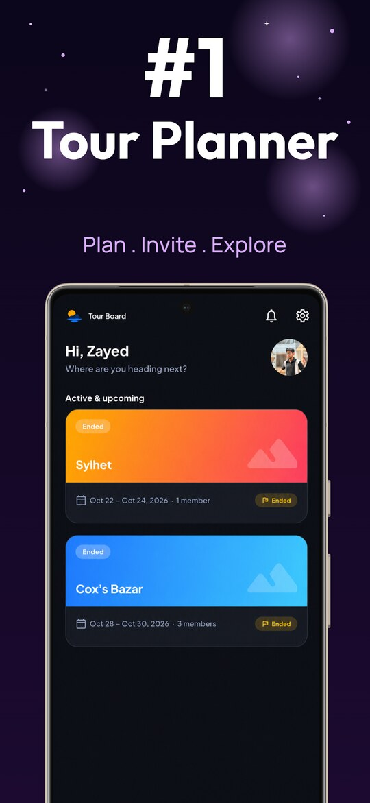
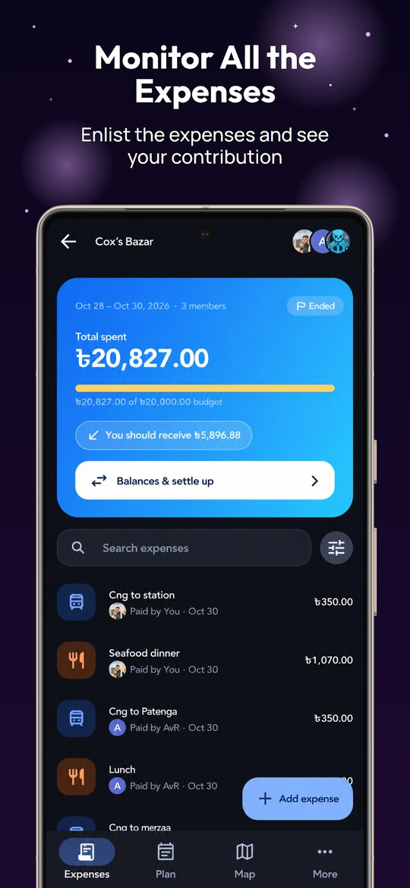
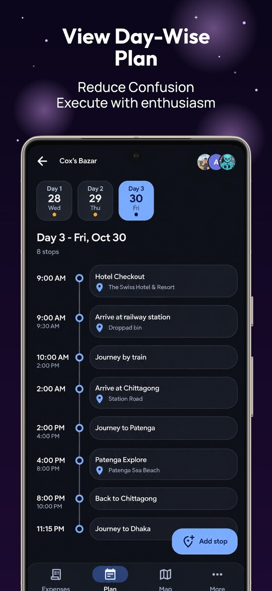
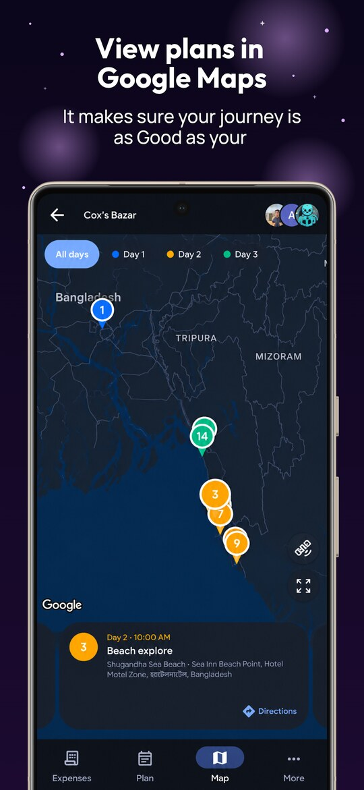

# Tour Board

Plan a trip together, record every shared expense, see who owes what, and
map the itinerary, all with a deliberately simple interface.

<a href="https://play.google.com/store/apps/details?id=com.techorbit.tour_board">Get it on Google Play</a>

<p>
  
  
  
  
</p>

**Highlights**

- The client is untrusted: every Firestore write is validated in [`firestore.rules`](firestore.rules), covered by 46 emulator tests in [`rules_test`](rules_test).
- Money is stored in integer minor units with deterministic splits, so every device computes the same balances. See [architecture](docs/ARCHITECTURE.md#money).
- Settling up takes at most n - 1 transfers, with a submit and confirm handshake for each payment.
- A small TypeScript backend ([Tour-Board-Backend](https://github.com/mdzayedoyshik/Tour-Board-Backend)) handles push notifications, data retention and Google place search, so no server key ships in the app.

> **Current setup status and remaining steps: [docs/SETUP_GUIDE.md](docs/SETUP_GUIDE.md).**

Flutter + Firebase (Auth, Cloud Firestore, Cloud Messaging) on the **Spark
(free) plan**, plus a small Node.js backend on Render
([Tour-Board-Backend](https://github.com/mdzayedoyshik/Tour-Board-Backend)) for
push notifications, daily data retention and Google place search. Client
access control lives in `firestore.rules`; the backend verifies every
request against Firestore.

| | |
|---|---|
| Android package | `com.techorbit.tour_board` |
| iOS bundle ID | `com.techorbit.tourBoard` |
| Flutter | 3.38.1 (stable), Dart 3.10 |
| State / navigation | Riverpod 3, go_router |
| Map | Google Maps SDK; place search via the backend (Places API New) |
| Backend | `https://tour-board-backend.onrender.com` (Node.js + TypeScript) |

Docs: [product spec](docs/PRODUCT_SPEC.md) · [architecture](docs/ARCHITECTURE.md)
· [Firestore schema](docs/FIRESTORE_SCHEMA.md) · [security rules](docs/SECURITY_RULES.md)
· [test plan](docs/TEST_PLAN.md) · [free-tier limits](docs/FREE_TIER_LIMITS.md)
· [original brief](docs/IMPLEMENTATION_BRIEF.md)

---

## 1. Firebase setup (one time)

Keep the project on **Spark**. Do not create a billing account.

1. Create a project in the [Firebase Console](https://console.firebase.google.com).
2. **Authentication → Sign-in method → Google → Enable.** Set a support email.
3. **Firestore Database → Create database** (production mode, pick a region).
4. Add the app with the FlutterFire CLI from the repo root:

   ```bash
   dart pub global activate flutterfire_cli
   firebase login
   flutterfire configure --project=<project-id> --platforms=android,ios \
     --android-package-name=com.techorbit.tour_board \
     --ios-bundle-id=com.techorbit.tourBoard
   ```

   This writes `lib/firebase_options.dart` (without it the app shows a
   "Setup needed" screen),
   `android/app/google-services.json` and `ios/Runner/GoogleService-Info.plist`.
   These hold public client config protected by Security Rules — **commit
   them** so CI can build. Never commit service-account keys.

5. **Android SHA fingerprints** (required for Google Sign-In; see
   `scripts/setup_release_signing.sh` for the upload key). Add the SHA-1
   and SHA-256 of every signing key in *Project settings → Your apps → Android*:

   ```bash
   # debug key
   keytool -list -v -keystore ~/.android/debug.keystore -alias androiddebugkey -storepass android
   # upload key
   keytool -list -v -keystore upload.jks -alias <alias>
   ```

   Also add the **Play App Signing** SHA-1/SHA-256 from Play Console → *Setup →
   App signing*. Re-run `flutterfire configure` afterwards so
   `google-services.json` contains the OAuth client (`default_web_client_id`).

6. **iOS Google Sign-In**: add the `REVERSED_CLIENT_ID` from
   `GoogleService-Info.plist` as a URL scheme in `ios/Runner/Info.plist`
   (next to the existing `tourboard` scheme), and set `GIDClientID` to its
   `CLIENT_ID`. Configure the OAuth consent screen in Google Cloud Console.

7. Deploy rules and indexes (only when you intend to):

   ```bash
   firebase use <project-id>
   firebase deploy --only firestore:rules,firestore:indexes
   ```

## 2. Optional app settings

`env/example.env` lists the backend URL (`API_BASE_URL`) and emulator
settings. All have defaults; copy to `env/dev.env` / `env/prod.env` to
override. These files are git-ignored; CI writes them from the `ENV_DEV` /
`ENV_PROD` secrets.

The Google Maps **app key** is a build setting, not an env value:
`android/properties/secrets.properties` (`MAPS_API_KEY=...`) locally,
`ios/Flutter/Secrets.xcconfig` for iOS, and the `MAPS_API_KEY` secret in CI.
See `docs/SETUP_GUIDE.md` §2.

## 3. Joining tours

Tours are joined with a 12-character code (e.g. `K7QM-4XPT-9C2B`) that the
host shares from *More → Invite people*. The recipient opens Tour Board →
*Join*, types the code and the host approves. No website, domain or deep
link is needed.

## 4. Run, test, emulate

```bash
flutter pub get
flutter run                         # dev (env/dev.env if present)
flutter analyze
flutter test                        # unit + widget tests

# Security Rules tests (needs Java 17+ and firebase-tools)
cd rules_test && npm ci && npm test
```

Local emulators: `firebase emulators:start --only auth,firestore`, then set
`USE_FIREBASE_EMULATOR=true` and `FIREBASE_EMULATOR_HOST=10.0.2.2` (Android
emulator) in `env/dev.env`.

On 8 GB machines Gradle is capped at 3 GB / 2 workers
(`android/gradle.properties`). Avoid running a Gradle build and the test
suite at the same time.

## 5. Release

```bash
flutter build appbundle --release --dart-define=ENV=prod
```

`.github/workflows/deploy.yml` runs on every push to `main`: analyze, test,
build APK + AAB, create a GitHub release and upload to the Play **internal**
track. Required repository secrets:

| Secret | Purpose |
|---|---|
| `KEYSTORE_BASE64` | base64 of the upload keystore (`base64 -w0 upload.jks`) |
| `KEY_STORE_PASSWORD`, `KEY_PASSWORD`, `KEY_ALIAS` | upload key credentials |
| `PLAY_STORE_JSON_KEY` | Play Console service-account JSON (CI only, never in the app) |
| `ENV_PROD`, `ENV_DEV` | optional contents of `env/prod.env` / `env/dev.env` |

Bump `version:` in
`pubspec.yaml` for every release; the first upload of a new app must be done
manually in Play Console. `.github/workflows/ci.yml` runs analyze, tests and
the rules tests on pull requests.

## 6. Known limitations (by design)

- **Push needs the backend.** The app only *reports* events; the backend
  verifies them and sends inbox items + FCM pushes. Render's free instance
  sleeps, so the first push after idle can take up to a minute.
- **No live location sharing** in this version; the map shows itinerary
  places only.
- **Client-written aggregates are not trusted.** Balances are recomputed from
  canonical expense and settlement records (bounded to the latest 1000
  expenses / 500 settlements per tour).
- **Automatic retention.** A daily job deletes expired join codes, 30-day-old
  notifications, finished join requests after 7 days and whole tours 30 days
  after their end date (members are warned a week before).
- **Tour size**: 30 active members (60 ever) and 30 participants per expense.
- Free tiers and provider policies change — see `docs/FREE_TIER_LIMITS.md`.

## Contributing

Issues and pull requests are welcome. See [CONTRIBUTING.md](CONTRIBUTING.md).

## License

[MIT](LICENSE) © Md. Zayed Oyshik
